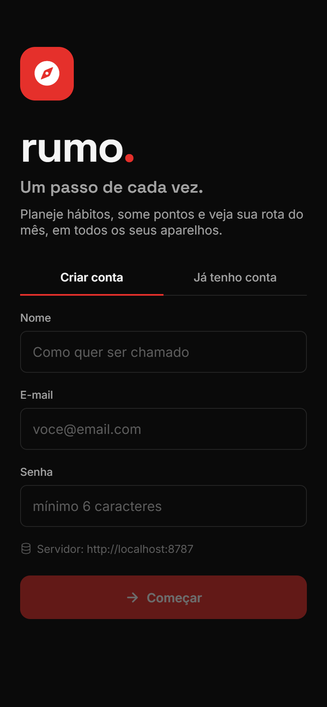
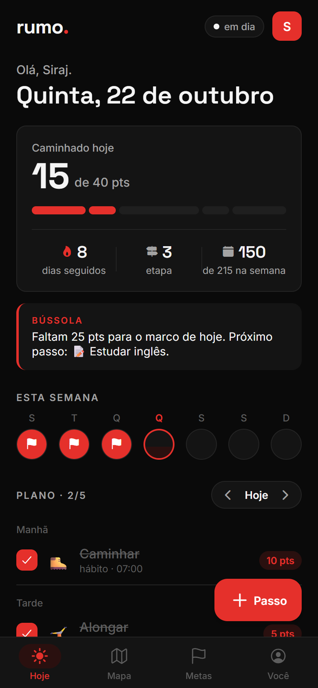
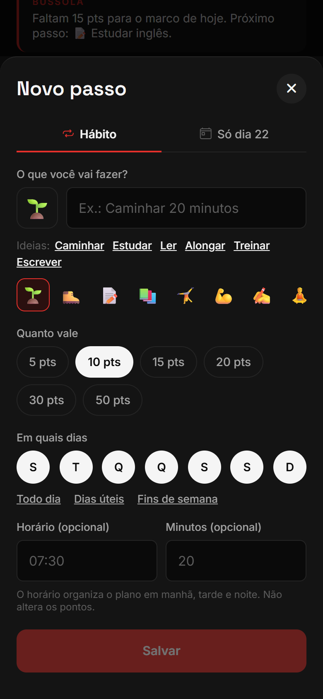
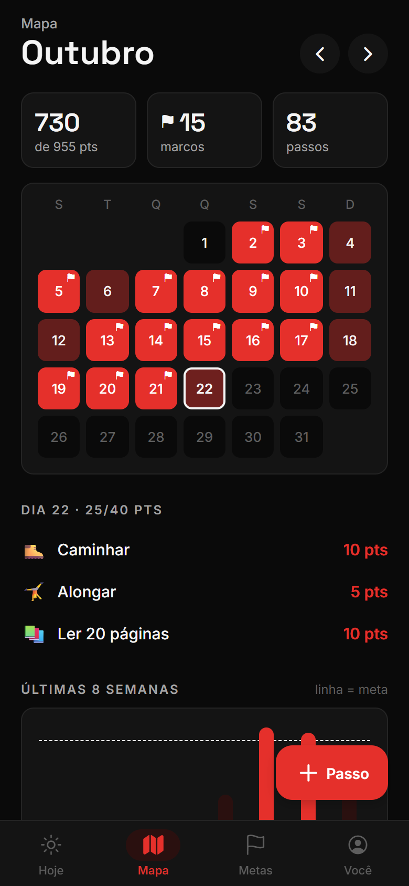
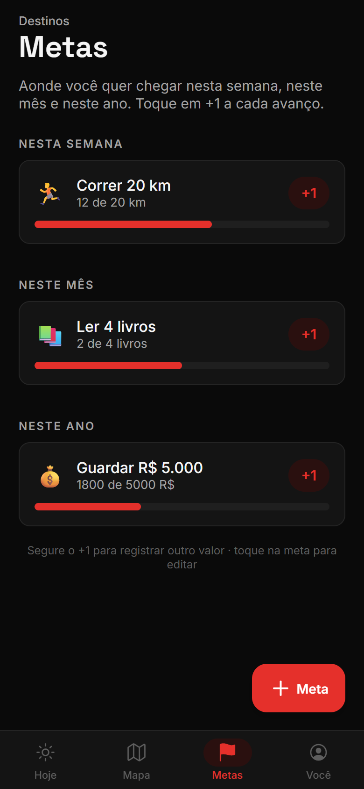
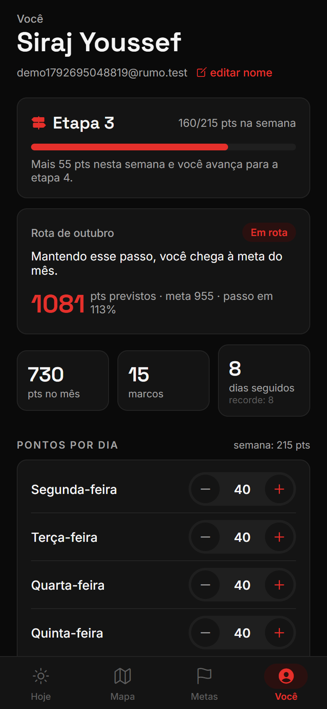

# Rumo: um passo de cada vez

App mobile (Android e iOS) para planejar hábitos, somar pontos, bater metas diárias e acompanhar a "rota" do mês, com **sincronização em tempo real** entre aparelhos e funcionamento offline.

Nasceu da análise de um app pessoal mostrado num vídeo do Instagram (`@adrian_valt`, 22/10/2026). Do vídeo veio só a **ideia geral**, que é comum a vários apps de hábitos (tarefas que valem pontos, metas por dia, sequência e calendário). Nome, marca, cores, tipografia, textos, layout, navegação e fluxos foram criados do zero.

| Entrada | Hoje | Novo passo | Mapa | Metas | Você |
|---|---|---|---|---|---|
|  |  |  |  |  |  |

---

## 1. Identidade própria (e o que mudou em relação ao app do vídeo)

| Aspecto | App do vídeo | Rumo |
|---|---|---|
| Nome e marca | "Evolving", logo de seta subindo | **Rumo**, logotipo `rumo.` com ponto vermelho e ícone de bússola; metáfora de trilha e caminho |
| Paleta | Escura, gradientes coral/rosa, brilho neon | **Preto e vermelho, minimalista**: preto `#0A0A0A`, grafite `#141414`, branco `#F5F5F5` e **um único vermelho chapado** `#E5302B`. Sem gradientes, sem brilho; o vermelho fica reservado para progresso, ação principal e aba ativa, e seleções usam branco |
| Tipografia | Sans geométrica única | **Space Grotesk** (títulos e números) + **Inter** (texto) |
| Navegação | 5 abas só com ícones + botão "+" central saltado | 4 abas com rótulo (**Hoje, Mapa, Metas, Você**) + botão "+ Passo / + Meta" contextual à direita |
| Criar item | Menu com 4 opções → formulário com stepper de pontos | Um formulário só ("Novo passo") com abas Hábito / Só um dia, pontos em pílulas (5–50), "Ideias" em texto |
| Progresso do dia | Anel circular + 3 cards laterais | Número grande + **barra-trilha** segmentada por tarefa + 3 indicadores em linha |
| Dica | Card "COACH" em gradiente | Faixa "**Bússola**" em grafite com filete vermelho à esquerda, que sugere o *próximo passo* concreto |
| Semana | Gráfico de barras verticais | 7 círculos que "enchem" conforme a meta; bandeira quando batida |
| Lista do dia | Faixa de 7 datas, itens com check à direita | Navegação ‹ Hoje ›, itens agrupados em **Manhã / Tarde / Noite / Qualquer hora**, check à esquerda |
| Calendário | Grade com ícones das tarefas e estrela | **Mapa de calor** do mês (intensidade = % da meta) + histórico de 8 semanas e hábitos mais constantes, tudo na mesma aba |
| Gamificação | Nível, estrelas, "No ritmo certo" | **Etapa**, **marcos** (bandeira), **Rota do mês** (Em rota / Perto da rota / Fora da rota) |
| Metas longas | Não aparecem no vídeo | Agrupadas por semana/mês/ano, com botão **+1** rápido (segurar = outro valor) |
| Ícone do app | Não aparece | Bússola branca com agulha vermelha sobre preto (`app/assets`, gerado em SVG) |

> **Sobre plágio e marca.** A ideia de um app de hábitos com pontos não é protegível; o risco estava em copiar nome, logo, identidade visual e textos, e isso foi todo refeito. O original também é escuro com tons quentes. O Rumo se diferencia pelo vermelho puro e chapado (sem gradiente coral nem brilho), pela tipografia, pela estrutura das telas e pela navegação; para distância visual máxima, evite reintroduzir gradientes. **"Rumo" é uma palavra comum e também nome de uma grande empresa brasileira de logística (Rumo S.A.).** A classe de serviço é outra, mas **faça uma busca no INPI** (classes 9 e 42) e nas lojas antes de publicar. Trocar o nome é simples: `app.json` (`name`, `slug`, `scheme`, ids), o logotipo em `TodayScreen.tsx`/`LoginScreen.tsx` e este README.

---

## 2. Funcionalidades

- **Hoje:** pontos do dia vs. meta, barra-trilha, dias seguidos, etapa, pontos da semana, dica da Bússola, semana em círculos e plano do dia por período. Dá para navegar para dias anteriores e concluir retroativamente; dias futuros ficam bloqueados.
- **Novo passo:** hábito recorrente (dias da semana, atalhos "Todo dia / Dias úteis / Fins de semana") ou passo de um dia só; ícone, pontos, horário e minutos opcionais; "Salvar e adicionar outro"; editar e excluir tocando no item.
- **Mapa:** mapa de calor do mês com marcos, resumo (pontos, marcos, passos), detalhe do dia, últimas 8 semanas com linha de meta, ranking de constância em 30 dias.
- **Metas:** destinos da semana, do mês e do ano com unidade livre (livros, km, R$…), +1 rápido e registro de valores maiores.
- **Você:** etapa e quanto falta, **Rota do mês** com previsão, pontos por dia da semana (a meta da semana e do mês é a soma), nome editável, sair.
- **Sincronização:** indicador no topo ("em dia", "sincronizando", "N pendentes", "offline").

**Regras** (`app/src/lib/model.ts`):
- **Marco:** dia em que os pontos alcançam a meta do dia.
- **Dias seguidos:** marcos consecutivos. Dias com meta 0 são livres e não quebram a sequência.
- **Etapa:** sobe a cada semana completa.
- **Rota:** pontos do mês ÷ meta acumulada desde o início de uso. A previsão é meta do mês × esse ritmo.

---

## 3. Stack e por quê

| Camada | Escolha | Justificativa |
|---|---|---|
| App | **Expo SDK 58 + React Native 0.88 + TypeScript** | Um código para Android e iOS; roda em aparelho real pelo **Expo Go**; gera **APK** e **TestFlight** pelo EAS sem Mac nem Android SDK local |
| UI | React Navigation 7 (abas com barra própria), `@expo-google-fonts` (Space Grotesk, Inter), `@expo/vector-icons` | Libs oficiais e mantidas; instaladas com `expo install` (versões compatíveis com o SDK) |
| Dados locais | AsyncStorage (snapshot JSON por usuário) | Volume pequeno; funciona em Android, iOS e web |
| Tempo real | **WebSocket próprio** (`ws` 8.22) | Sem depender de serviço proprietário; protocolo de recuperação e conflitos sob nosso controle |
| Servidor | Node 24 + `node:sqlite` nativo + `ws` | Uma dependência; um arquivo `.db`; Docker |
| HTTPS/WSS | Caddy (Let's Encrypt automático) | Mesmo padrão do n8n-copilot-stack |

---

## 4. Arquitetura

```
 ┌──────────── Celular A ────────────┐        ┌──────────── Celular B ────────────┐
 │ Telas (React)                     │        │ Telas (React)                     │
 │   ▲ useDb() / useSyncStatus()     │        │                                   │
 │ store.ts  banco local + outbox    │        │ store.ts                          │
 │   │  put()/remove() → outbox      │        │   ▲ applyRemote() (LWW)           │
 │ sync.ts  WebSocket ───────────────┼──┐  ┌──┼── sync.ts                         │
 │  backoff, ping/pong, lotes c/ ack │  │  │  │                                   │
 └───────────────────────────────────┘  │  │  └───────────────────────────────────┘
                                         ▼  │
                     ┌──────── server (Node) ────────────────┐
                     │ HTTP  /auth/register /auth/login /me  │
                     │ WS    /sync  hello → catch-up → live  │
                     │ db.js applyOps(): LWW + seq por user  │
                     │ SQLite: users, sessions, records      │
                     └───────────────────────────────────────┘
```

**Protocolo** (documentado no topo de `server/src/server.js`):
1. O app conecta em `/sync` e envia `hello {token, deviceId, since: lastSeq}`.
2. O servidor manda tudo com `seq > lastSeq`, depois `synced`, e passa a repassar ao vivo as mudanças dos outros aparelhos do mesmo usuário.
3. Edições locais entram na **outbox** e sobem em lotes (`push`). O servidor responde `ack` com a versão vencedora de cada registro. Só sai da outbox o que foi confirmado e não foi editado de novo nesse meio-tempo.
4. **Conflito:** *last writer wins* por registro (timestamp, com `deviceId` como desempate), a mesma regra no app e no servidor. Ao editar, o app usa `max(agora, versão atual + 1)`, então uma edição feita depois de ver a de outro aparelho sempre vence, mesmo com o relógio atrasado.
5. **Celular real:** reconexão com backoff exponencial + jitter (1 s → 30 s), reconexão imediata ao voltar do background, ping a cada 20 s (sem resposta em 10 s, a conexão é refeita), heartbeat do servidor a cada 30 s, timeout de 15 s no ack e gravação local ao ir para o background.

**Coleções sincronizadas:** `tasks`, `completions` (id `tarefa@data`), `settings` (`goals`, `profile`), `goals`, `goalLogs`.

---

## 5. Código-fonte

```
├── app/                          Expo (Android + iOS; web só para testes)
│   ├── App.tsx                   fontes, sessão, abas, botão "+" contextual, sheets
│   ├── app.json / eas.json       config nativa e perfis de build (APK, TestFlight)
│   ├── assets/                   ícone, ícone adaptativo Android, splash, favicon
│   └── src/
│       ├── theme.ts              paleta e fontes da marca
│       ├── data/   store.ts (banco local + outbox) · sync.ts (WebSocket) · session.ts · types.ts
│       ├── lib/    model.ts (pontos, marcos, etapa, rota, Bússola) · dates.ts · confirm.ts
│       ├── components/ ui.tsx (Card, Button, Toggle, ChoicePills, Nudge, Sheet…) · widgets.tsx (TrailBar, WeekDots, DayNav, TaskRow, SyncDot)
│       ├── sheets/ TaskSheet (Novo passo) · GoalSheets
│       └── screens/ Today · Map · Goals · You · Login
├── server/   src/{index,server,db,auth}.js · test/sync.test.js · Dockerfile
├── deploy/   docker-compose.yml + Caddyfile (HTTPS/WSS)
└── docs/telas/                   screenshots
```

---

## 6. Rodar e instalar

**Pré-requisitos:**
- Node 22.13 ou mais novo (testado com 24.21).
- **Expo Go** no celular, na mesma rede Wi-Fi do PC.
- Conta gratuita em expo.dev, para gerar APK/TestFlight.

### 6.1 Servidor
```bash
cd server
npm install
npm test        # 6 testes: tempo real, recuperação offline, conflito, isolamento, auth, validação
npm start       # porta 8787; mostra os IPs para usar no celular
```
No Windows, libere a porta 8787 no firewall (rede privada).

### 6.2 App no celular (Expo Go)
```bash
cd app
npm install
npx expo start
```
Escaneie o QR code. O app sugere o servidor no IP do PC (`http://<ip>:8787`); dá para trocar em "Servidor" no login. Para ver o tempo real, entre com a mesma conta em dois aparelhos.

### 6.3 APK (Android)
```bash
npm install -g eas-cli
cd app
eas login
eas init                      # vincula o projeto à sua conta (uma vez)
EAS_NO_VCS=1 eas build -p android --profile preview
```
O servidor padrão do app vem de `EXPO_PUBLIC_SERVER_URL` no perfil `preview` do **`app/eas.json`**. O build roda na nuvem do Expo, que **não** lê variáveis do seu terminal. Hoje ele aponta para o IP do PC no Wi-Fi (`http://192.168.1.65:8787`), que só funciona na mesma rede e com `npm start` rodando no servidor. Para usar fora de casa, troque por `https://rumo.seudominio.com` (seção 6.5) e gere de novo. Em qualquer caso, o usuário pode mudar o servidor na tela de login.

`EAS_NO_VCS=1` envia a pasta sem exigir commit no git (no PowerShell: `$env:EAS_NO_VCS="1"` antes). O EAS devolve um link/QR do `.apk`; instale no Android permitindo "fontes desconhecidas".

### 6.4 iOS (TestFlight)
```bash
eas build -p ios --profile production
eas submit -p ios
```
Exige Apple Developer (US$ 99/ano). Antes disso, teste pelo Expo Go.

### 6.5 Servidor em produção
```bash
cd deploy
echo DOMINIO=rumo.seudominio.com > .env
docker compose up -d --build
```

---

## 7. Limitações e pontos a validar

- **Nome:** verificar disponibilidade de "Rumo" no INPI e nas lojas (ver nota na seção 1). Os ids `app.rumo.habitos` são provisórios; troque pelo domínio da sua empresa.
- **Inferido, não visto no vídeo:** estatísticas e metas longas (a narração cita "metas pro ano, pro mês, pra semana"). As regras de etapa e rota foram definidas por nós.
- **Sem push:** notificações não foram implementadas. Lembretes no horário do passo seriam o próximo passo (`expo-notifications`); push remoto exige FCM/APNs.
- **Conflito por registro inteiro**, não por campo. Exclusões ficam como tombstones; não há recuperação de senha nem exclusão de conta.
- **Só tema escuro** (preto e vermelho). Os tokens ficam em `app/src/theme.ts`; um tema claro exigiria só uma segunda paleta e a troca por `useColorScheme`.
- **HTTP sem TLS** só em rede local (Android `usesCleartextTraffic`, iOS `NSAllowsLocalNetworking`). Em produção, use `https://`.
- **Verificado:** testes do servidor 6/6; `tsc` sem erros; `expo-doctor` 20/20; bundles Android e iOS (Hermes) via `expo export`; navegação real em Edge headless com dois "aparelhos" separados (marcar uma tarefa em A mudou o plano de B de 2/5 para 3/5 em menos de 1,5 s); na versão anterior também testamos fila offline e reentrega; imagem Docker do servidor sobe e responde `/health`.
- **Não verificado:** celular físico, build EAS (precisa da sua conta Expo) e HTTPS do Caddy (precisa de domínio).
