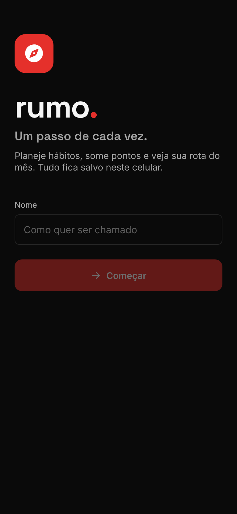

# Rumo: um passo de cada vez

App de celular (**Android**) para planejar hábitos, somar pontos, bater metas diárias e acompanhar a "rota" do mês. **Sem conta, sem servidor e sem internet:** tudo fica salvo no próprio celular. O APK é gerado de graça pelo GitHub.

Nasceu da análise de um app pessoal mostrado num vídeo do Instagram (`@adrian_valt`, 22/10/2026). Do vídeo veio só a **ideia geral**, que é comum a vários apps de hábitos (tarefas que valem pontos, metas por dia, sequência e calendário). Nome, marca, cores, tipografia, textos, layout, navegação e fluxos foram criados do zero.

| Entrada | Hoje | Novo passo | Mapa | Metas | Você |
|---|---|---|---|---|---|
|  |  |  |  |  |  |

---

## 1. Identidade própria (e o que mudou em relação ao app do vídeo)

| Aspecto | App do vídeo | Rumo |
|---|---|---|
| Nome e marca | "Evolving", logo de seta subindo | **Rumo**, logotipo `rumo.` com ponto vermelho e ícone de bússola; metáfora de trilha e caminho |
| Paleta | Escura, gradientes coral/rosa, brilho neon | **Preto e vermelho, minimalista**: preto `#0A0A0A`, grafite `#141414`, branco `#F5F5F5` e **um único vermelho chapado** `#E5302B`. Sem gradientes, sem brilho; o vermelho fica reservado para progresso, ação principal e aba ativa, e seleções usam branco |
| Tipografia | Sans geométrica única | **Space Grotesk** (títulos e números) + **Inter** (texto) |
| Navegação | 5 abas só com ícones + botão "+" central saltado | 4 abas com rótulo (**Hoje, Mapa, Metas, Você**) + botão "+ Passo / + Meta" contextual à direita |
| Criar item | Menu com 4 opções → formulário com stepper de pontos | Um formulário só ("Novo passo") com abas Hábito / Só um dia, pontos em pílulas (5–50), "Ideias" em texto |
| Progresso do dia | Anel circular + 3 cards laterais | Número grande + **barra-trilha** segmentada por tarefa + 3 indicadores em linha |
| Dica | Card "COACH" em gradiente | Faixa "**Bússola**" em grafite com filete vermelho à esquerda, que sugere o *próximo passo* concreto |
| Semana | Gráfico de barras verticais | 7 círculos que "enchem" conforme a meta; bandeira quando batida |
| Lista do dia | Faixa de 7 datas, itens com check à direita | Navegação ‹ Hoje ›, itens agrupados em **Manhã / Tarde / Noite / Qualquer hora**, check à esquerda |
| Calendário | Grade com ícones das tarefas e estrela | **Mapa de calor** do mês (intensidade = % da meta) + histórico de 8 semanas e hábitos mais constantes, tudo na mesma aba |
| Gamificação | Nível, estrelas, "No ritmo certo" | **Etapa**, **marcos** (bandeira), **Rota do mês** (Em rota / Perto da rota / Fora da rota) |
| Metas longas | Não aparecem no vídeo | Agrupadas por semana/mês/ano, com botão **+1** rápido (segurar = outro valor) |
| Ícone do app | Não aparece | Bússola branca com agulha vermelha sobre preto (`app/assets`, gerado em SVG) |

> **Sobre plágio e marca.** A ideia de um app de hábitos com pontos não é protegível; o risco estava em copiar nome, logo, identidade visual e textos, e isso foi todo refeito. O original também é escuro com tons quentes. O Rumo se diferencia pelo vermelho puro e chapado (sem gradiente coral nem brilho), pela tipografia, pela estrutura das telas e pela navegação; para distância visual máxima, evite reintroduzir gradientes. **"Rumo" é uma palavra comum e também nome de uma grande empresa brasileira de logística (Rumo S.A.).** A classe de serviço é outra, mas **faça uma busca no INPI** (classes 9 e 42) e nas lojas antes de publicar. Trocar o nome é simples: `app.json` (`name`, `slug`, `scheme`, ids), o logotipo em `TodayScreen.tsx`/`LoginScreen.tsx` e este README.

---

## 2. Funcionalidades

- **Hoje:** pontos do dia vs. meta, barra-trilha, dias seguidos, etapa, pontos da semana, dica da Bússola, semana em círculos e plano do dia por período. Dá para navegar para dias anteriores e concluir retroativamente; dias futuros ficam bloqueados.
- **Novo passo:** hábito recorrente (dias da semana, atalhos "Todo dia / Dias úteis / Fins de semana") ou passo de um dia só; ícone, pontos, horário e minutos opcionais; "Salvar e adicionar outro"; editar e excluir tocando no item.
- **Mapa:** mapa de calor do mês com marcos, resumo (pontos, marcos, passos), detalhe do dia, últimas 8 semanas com linha de meta, ranking de constância em 30 dias.
- **Metas:** destinos da semana, do mês e do ano com unidade livre (livros, km, R$…), +1 rápido e registro de valores maiores.
- **Você:** etapa e quanto falta, **Rota do mês** com previsão, pontos por dia da semana (a meta da semana e do mês é a soma), nome editável.

**Regras** (`app/src/lib/model.ts`):
- **Marco:** dia em que os pontos alcançam a meta do dia.
- **Dias seguidos:** marcos consecutivos. Dias com meta 0 são livres e não quebram a sequência.
- **Etapa:** sobe a cada semana completa.
- **Rota:** pontos do mês ÷ meta acumulada desde o início de uso. A previsão é meta do mês × esse ritmo.

---

## 3. Instalar no celular (Android)

No celular, abra **https://github.com/Siraj-Youssef/app-valt/raw/apk/Rumo.apk**: o download começa direto. Depois abra o `Rumo.apk` e permita **instalar apps desconhecidos** para o navegador ou o gerenciador de arquivos.

Esse link sempre aponta para o APK mais recente. O mesmo arquivo fica em **Actions → Gerar APK → execução mais recente → Artifacts**, e uma tag `v1.0.0` (em **Releases → Draft a new release**) anexa o APK a uma Release.

**Atualizar:** instale o APK novo por cima. Os dados continuam lá, porque todo build é assinado com a mesma chave.

O APK é gerado a cada push que mexe em `app/`, pelo workflow [`.github/workflows/release.yml`](.github/workflows/release.yml). Isso não custa nada, porque o repositório é público.

---

## 4. Onde ficam os dados

- Tudo fica no armazenamento do app (AsyncStorage) dentro do celular. Nada sai do aparelho.
- **Desinstalar o app ou limpar os dados dele apaga tudo.** Se o backup do Google estiver ligado no celular (Configurações → Google → Backup), o Android costuma salvar os dados dos apps e restaurá-los ao reinstalar, mas isso depende do aparelho.
- Trocar de celular não leva os dados automaticamente. Exportar e importar um arquivo de backup seria uma melhoria simples, se fizer falta.

---

## 5. Código-fonte

```
├── app/                          Expo SDK 58 + React Native + TypeScript
│   ├── App.tsx                   fontes, primeira abertura (nome), abas, botão "+" contextual, sheets
│   ├── app.json / eas.json       config nativa e perfis de build do EAS (opcional)
│   ├── assets/                   ícone, ícone adaptativo Android, splash
│   └── src/
│       ├── theme.ts              paleta e fontes da marca
│       ├── data/   store.ts (banco local) · types.ts
│       ├── lib/    model.ts (pontos, marcos, etapa, rota, Bússola) · dates.ts · confirm.ts
│       ├── components/ ui.tsx · widgets.tsx (TrailBar, WeekDots, DayNav, TaskRow)
│       ├── sheets/ TaskSheet (Novo passo) · GoalSheets
│       └── screens/ Welcome · Today · Map · Goals · You
├── .github/workflows/release.yml gera o APK
└── docs/telas/                   screenshots
```

As versões anteriores (servidor próprio em Node e depois Supabase + versão para computador) continuam no histórico do git.

---

## 6. Desenvolvimento

```bash
cd app
npm install
npx expo start       # abre no celular pelo app Expo Go (mesma rede Wi-Fi) ou no navegador (tecla w)
npx tsc --noEmit     # checagem de tipos
```

**EAS (opcional):** `app/eas.json` também gera o APK pela nuvem do Expo (`npx eas-cli build -p android --profile preview`) e, com a conta Apple de US$ 99/ano, a versão de iPhone.

---

## 7. Limitações

- **Só Android** como app instalável. iPhone exige a conta Apple paga.
- **APK assinado com a chave de debug do modelo do Expo:** instala e atualiza direto no celular, mas não serve para a Play Store.
- **Sem lembretes:** notificações no horário do passo seriam o próximo passo (`expo-notifications`).
- **Nome:** verificar disponibilidade de "Rumo" no INPI e nas lojas (ver nota na seção 1). Os ids `app.rumo.habitos` são provisórios.
- As telas 1 a 6 acima são da versão anterior e ainda mostram o indicador de sincronização no topo, que foi retirado.
